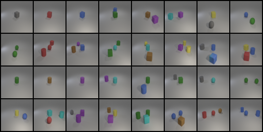
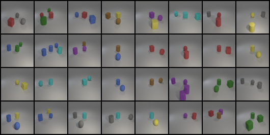
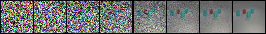

# Conditional DDPM for Multi-Object Image Generation

這是一個以 PyTorch 從頭實作的擴散模型 (Diffusion Model) 專案。使用 **i-CLEVR** 資料集（8 種顏色 × 3 種形狀，共 24 種物件），根據輸入的多標籤條件（例如「紅色球體、青色圓柱、青色方塊」）生成對應的多物件影像，並以預訓練的 ResNet18 分類器評估生成結果是否符合條件。

完整實驗報告：[report.pdf](./report.pdf)

## 💡 核心技術與特色 (Features)
* **條件式 DDPM**：1000 步的前向加噪 / 反向去噪流程，模型學習預測加入的高斯雜訊 ε（MSE loss）。
* **Cosine Noise Schedule**：相較於 linear schedule，訊噪比變化更平滑，前段時間步保留更多影像資訊。
* **Conditional U-Net**：下採樣 / 上採樣殘差區塊搭配 skip connections；sinusoidal 時間嵌入與 24 維 multi-hot 標籤嵌入相加後，注入每一個殘差區塊。
* **Classifier-Free Guidance (CFG)**：訓練時以 10% 機率丟棄條件，同時學會有條件與無條件去噪；取樣時以 `ε = ε_uncond + s · (ε_cond − ε_uncond)` 強化條件控制，guidance scale s = 3.5 效果最佳。

## 📂 專案架構 (Project Structure)
```text
├── dataset.py           # i-CLEVR 資料集載入與 multi-hot 標籤編碼
├── model.py             # Conditional U-Net（時間 / 條件嵌入、殘差區塊）
├── ddpm.py              # 擴散流程：noise schedule、加噪與去噪取樣
├── train.py             # 訓練主程式（支援 CFG、AMP、checkpoint 接續）
├── sample.py            # 依條件生成影像、計算準確率、輸出去噪過程
├── results/             # 生成結果
│   ├── test_grid.png
│   ├── new_test_grid.png
│   ├── denoising_process.png
│   └── images/          # 每一張生成影像
├── report.pdf           # 完整實驗報告
└── README.md
```

## 🚀 快速開始 (Quick Start)

### 1. 開始訓練模型
```bash
python train.py --image_dir <iclevr_images> --train_json_path train.json --object_json_path objects.json --checkpoint_dir checkpoints
```

### 2. 依條件生成影像並評估
```bash
python sample.py --lab_dir <dir_with_evaluator> --checkpoint_path checkpoints/epoch_190.pth --guidance_scale 3.5 --output_dir results
```
`sample.py` 會使用課程提供的評估器（`evaluator.py` 與其 `checkpoint.pth`，放在 `--lab_dir`）計算準確率，該評估器不包含在本 repo 中。可用 `python train.py -h`、`python sample.py -h` 查看所有參數。

## 📈 實驗結果 (Results)
以預訓練 ResNet18 多標籤分類器評估生成影像的準確率：

| 模型 | test.json | new_test.json |
| --- | --- | --- |
| Baseline Conditional DDPM | 73.6% | 76.2% |
| **+ Classifier-Free Guidance (s = 3.5, epoch 190)** | **80.6%** | **90.5%** |

**生成結果**：`test.json`（左）與 `new_test.json`（右）

<p>
  
  
</p>

**去噪過程**：條件為 `["red sphere", "cyan cylinder", "cyan cube"]`，模型先還原整體配置，再逐步修飾物件的形狀與顏色。


